<div align="center">


# Anode

**Cool Mist Light & Slate Steel Telemetry**  
面向 [NodeSeek](https://www.nodeseek.com) 主机与开发者社区的原生 Jetpack Compose / Material 3 Expressive Android 客户端

[](https://github.com/learningdog1/Anode/releases/latest)
[-0B7A75?style=for-the-badge&logo=android&logoColor=white)](https://github.com/learningdog1/Anode/releases/latest)
[](https://kotlinlang.org)
[](https://developer.android.com/compose)
[](LICENSE)

[📥 下载安装](#-下载与安装--download--install) ·
[🎨 三态视觉主题](#-三态视觉主题同屏对比--themes--design-philosophy) ·
[✨ 全页面功能图鉴](#-核心功能与全页面图鉴--feature--screen-walkthrough) ·
[🏗️ 工程架构](#️-工程架构--architecture) ·
[🛠️ 构建与测试](#️-本地构建与测试--build--verification)

</div>

---

## 📥 下载与安装 · Download & Install

> [!TIP]
> 前往 [**GitHub Releases (`v2.13.1`)**](https://github.com/learningdog1/Anode/releases/latest) 下载已签名正式版 APK（`Anode-v2.13.1-release.apk`），下载后可直接在 Android 设备安装（后续亦可在应用内检查与升级）。

| 项目 | 说明 |
| :--- | :--- |
| **应用名称 / 包名** | `Anode`（`com.nodeseek.app`） |
| **当前版本** | `v2.13.1`（`versionCode = 29`） |
| **系统要求** | Android 8.0 及以上（`minSdk = 26` · `targetSdk = 36`） |
| **核心模块一览** | 极简脉冲首页与自定义排序全版块频道栏 · 独立全站统一搜索 · 杂志级帖子阅读器（ANSI / 多标签页 / 表情贴纸 / 投票与星尘打赏 / 帖子长图二维码分享） · Markdown 发帖、隐私打码编辑与 NodeImage 云端图库管理 · 15 币种 VPS 估值折算器（支持按总价/溢价双向折算）、同款市场溢价参考（正向白名单机型提取、双向总价/溢价中位参考与防 404 兜底）、交易闭环核验清单与拼车合租工具 · 悬浮三标签底栏（`首页 / 功能栏 / 我的`）与功能聚合中心 · 隔离式 Seek 邮箱 (`seek.li`)、OTP 验证码守望一键复制与 VPS/域名账单自动入库 · 签名加密社区活动聚合与 drand 公平抽奖 · 多账号隔离切换、个人中心一行签到、鸡腿/星尘账本与邀请码/仲裁记录 · 统一信息流卡片的收藏、足迹与个人空间 · 聚合收件箱与实时私信 · WorkManager 后台脉搏雷达与外部告警转发（Telegram / Bark / Webhook） · VPS 补货监控 · 卖家交易信誉卡 · 哪吒/Komari 探针 2s 实时遥测、VPS 资产账本与域名 RDAP/TLS 证书巡检 · 手机端 ICMP Ping / TCPing / `-P` 原生 iperf3 / 双向 Traceroute 骨干网线路识别与物理网络绑定 · 轻量 SSH（探针同步保险库 / WebSocket 探针终端与直连 SSH / SFTP 可视化文件抽屉 / ProxyJump / NodeQuality 四栏导出与历史测评基线对比） · LET 签名加密海外情报聚合 · Jetpack Glance 桌面小组件与 App Shortcuts 快捷入口 · 内容过滤屏蔽 · 双模式本地备份恢复（v1 明文 + v2 口令加密） · 平板/折叠屏双栏适配 · 分组卡片式设置与 GitHub Releases 应用内更新 |

---

## 🎨 三态视觉主题同屏对比 · Themes & Design Philosophy

**Anode** 将日间技术杂志的舒朗通透感与夜间机房遥测面板的锐利对比融于同一套 **Material 3 Expressive** 自适应色彩引擎：

- **清雾冰蓝浅色 (`Cool Mist Light`)**：清透冰蓝雾白画布（`#F7FAFF`）搭配纯白底板（`#FFFFFF`）、细密边框（`#C0C7CD`）与沉稳青钢蓝主色（`#2D637E` / 容器 `#CDE7FB`），清爽护眼、层次分明。
- **深岩钢蓝深色 (`Slate Steel Dark`)**：低辉度岩灰暗色画布（`#101417`）与板岩容器（`#1C2024`），配合澄澈天青蓝（`#9ACAEC` / 容器 `#114B66`）高对比点缀。
- **纯净极黑省电 (`Pure Pitch AMOLED`)**：支持纯黑 `#000000` 画布与低功耗深碳容器（`#111518`），专为 OLED 屏幕优化夜间阅读对比度。
- **Material You 壁纸动态取色与首页双轴独立字号/卡片缩放**：默认关闭动态取色以呈现标志性的清雾浅色 / 深岩深色主题（支持在设置中一键开启 Android 12+ Material You 壁纸动态取色）；其余所有页面卡片与字号固定为 **`90%`** 视觉基准，设置中支持对**首页帖子卡片字号**与**首页卡片大小**分别单独设置（默认 `90%`，各自支持 `60%–130%` 宽幅自由调节，同屏可展示更多帖子且跨比例自动防裁切）。开启壁纸动态取色时，毛玻璃顶栏、卡片描边、`发帖` 悬浮按钮、顶部光晕与底栏指示器同步随壁纸色板联动；内置 **15 套版块语义色系**、**Lv.0–Lv.6 宝石/金属等级光环**（精确按 `coins >= 100 × Lv²` 换算）与 **Drumstick Amber (`🍗`)** 鸡腿激励体系。

<div align="center">
<table>
  <tr>
    <th width="33%">☀️ 清雾浅色 · Cool Mist Light</th>
    <th width="33%">🌙 深岩深色 · Slate Steel Dark</th>
    <th width="33%">🖤 纯黑省电 · Pure Pitch AMOLED</th>
  </tr>
  <tr>
    <td align="center"></td>
    <td align="center"></td>
    <td align="center"></td>
  </tr>
</table>
</div>

<div align="center">
<table>
  <tr>
    <th width="33%">🌿 绿色壁纸 · 动态取色浅色</th>
    <th width="33%">🌺 红色壁纸 · 动态取色深色</th>
    <th width="33%">🍀 个人中心 · 动态取色联动</th>
  </tr>
  <tr>
    <td align="center">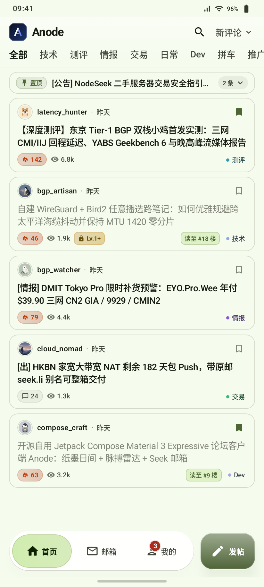</td>
    <td align="center">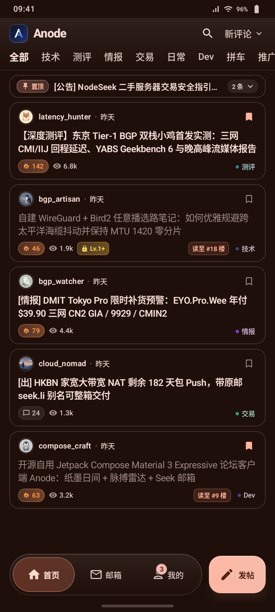</td>
    <td align="center">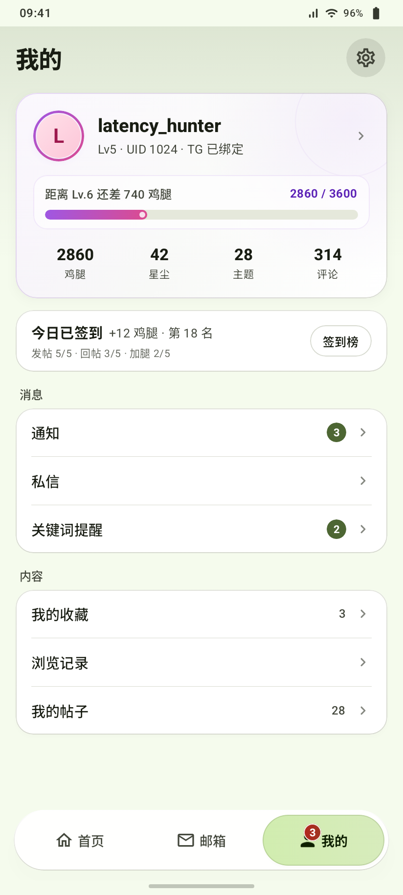</td>
  </tr>
</table>
</div>

---

## ✨ 核心功能与全页面图鉴 · Feature & Screen Walkthrough

### 1. 脉冲首页与悬浮药丸导航 (`Explore & Navigation Shell`)

- **极简毛玻璃顶栏与全版块轨道**：左上角保留 `Anode` 品牌徽标，右侧收敛为搜索图标按钮与极简排序选择器（`新评论 ▾` / `新帖子` / `热门` / `推荐阅读`）；第二行为无框极简文字频道条（`全部` + `技术 / 测评 / 情报 / 交易 / 日常 / Dev` 及全站所有非管理员版块），与下方 `HorizontalPager` 1:1 丝滑联动。
- **高密度通透信息流**：
  - **CollapsiblePinnedTicker**：轻量化透明线框置顶公告条，默认折叠，一键展开查看全站置顶。
  - **PulseTopicCard**：剔除厚重卡片底色与左侧竖条，采用通透圆角线框卡片并优化垂直排布密度（单屏可完整浏览 5+ 篇主题）；版块标识以无底色语义小圆点 + 文字置于卡片右下角，已读/未读通过字重与墨色清晰区分，并支持 `读至 #N 楼` 续读标签、热帖火焰徽章与一键收藏。
  - **RSS 快速降级通道**：未登录游客态在首页第 1 页（非内版）触发临时安全校验或开启偏好时自动切换 RSS 快速预览，保证随时可读。
- **单手拇指区与大屏适配**：悬浮毛玻璃药丸底栏采用 **`首页` / `功能栏` / `我的`** 三标签架构，配以弹性渐隐 Squircle `发帖` FAB；在首页再次点按「首页」自动平滑置顶并触发刷新；在平板与展开折叠屏（`width >= 600dp`）下通过 `AdaptiveLayout` 自动切换为左侧 `NavigationRail` 与主从双栏阅读视图。

---

### 2. 全站统一搜索与离线收藏足迹 (`Unified Search & Offline Collections`)

<div align="center">
<table>
  <tr>
    <th width="50%">🔍 帖子 / 成员统一搜索与 Google 兜底</th>
    <th width="50%">🔖 离线收藏快照与楼层续读足迹</th>
  </tr>
  <tr>
    <td align="center">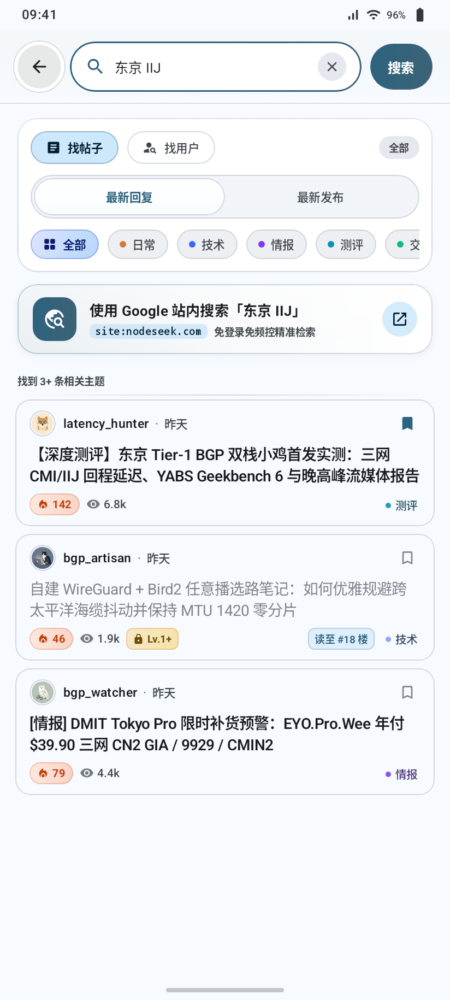</td>
    <td align="center">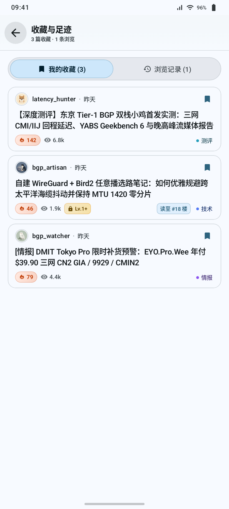</td>
  </tr>
</table>
</div>

- **全站统一搜索 (`SearchRoute`)**：点击首页右上角搜索图标直达独立全站搜索页，支持按 `找帖子`（含分类/排序筛选与分页加载）与 `找用户`（`@username`）检索，自动持久化最近搜索标签，并在底部提供 **1 键 Google `site:www.nodeseek.com` 站外搜索** 卡片。
- **离线收藏与阅读足迹 (`HubCollectionScreen`)**：从“我的”页面直达独立的「收藏与足迹」二级页，与首页统一采用 `PulseTopicCard` 通透线框帖子卡片设计；集中管理云端与 Room 本地离线快照收藏（支持无网离线阅读与一键取消收藏），并在浏览历史中完整保留版块分类标签与 `读至 #N 楼` 续读标签，支持一键续读、收藏与清空记录。

---

### 3. 杂志级帖子阅读器与表情回复工作台 (`Topic Reader & Reply Composer`)

<div align="center">
<table>
  <tr>
    <th width="50%">📖 杂志级排版 · ANSI 跑分 · 多标签卡</th>
    <th width="50%">💬 引用回复 · 实时预览 · 社区贴纸库</th>
  </tr>
  <tr>
    <td align="center"></td>
    <td align="center"></td>
  </tr>
</table>
</div>

- **原生 Compose `MarkdownRenderer`**：
  - **ANSI SGR 终端彩色代码块**：原生解析 `\u001B[...m` 控制符，高保真渲染 YABS、NextTrace、Geekbench 等 VPS 测速脚本输出，支持一键复制源码。
  - **交互式多标签页 (`:::: tabs` / `::: tab-item`)**：长篇评测内的「YABS 跑分 / 三网回程 / 流媒体解锁」可在卡片内直接切换。
  - **完整 GFM 与社区语法**：支持横向滚动表格、Electric Cobalt 引用块、任务列表、可点击 `@用户` / `#楼层` 跳转芯片、`/jump?to=` 外链安全解包、双指缩放灯箱看图（Coil 3 + Referer 策略），以及官方 `:ac01:` / `:yct001:` / `:xhj001:` 动态与静态贴纸集。
- **阅读与互动人体工学**：支持 `只看楼主`、倒序浏览、长按自由划词复制、楼层 `🍗 加鸡腿` / `👍 点赞` / `👎 踩`（含消耗确认弹窗与实时余额同步）、右侧可拖拽**震动楼层滑块 (`RightEdgeFloorScrubber`)** 与跳楼弹窗。
- **回复工作台 (`ReplyComposerBottomSheet`)**：支持引用任意楼层 `@user #N`、本地草稿自动保存、`编辑 / 预览` 双栏切换、官方贴纸面板、NodeImage 图床直传以及一键调用 VPS 估值器插入回复。

---

### 4. Markdown 发帖编辑器与 VPS 剩余价值估值器 (`Topic Composer & VPS Valuation`)

<div align="center">
<table>
  <tr>
    <th width="50%">✍️ 全功能 Markdown 发帖与编辑</th>
    <th width="50%">🧮 13 币种 VPS 剩余价值与交易折算</th>
  </tr>
  <tr>
    <td align="center"></td>
    <td align="center">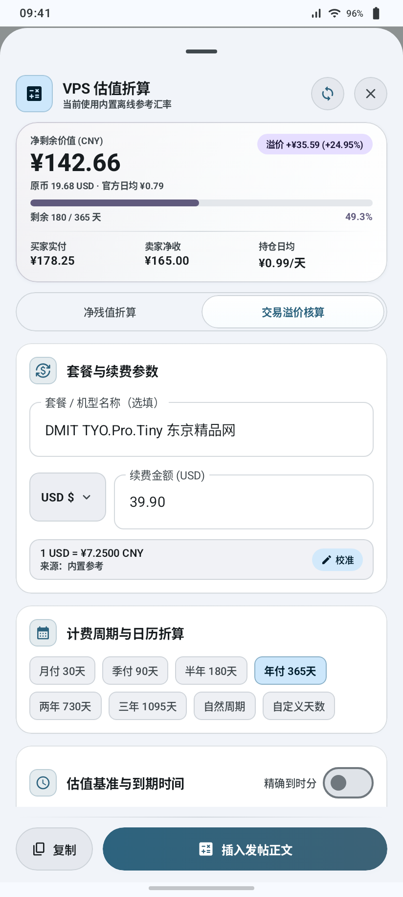</td>
  </tr>
</table>
</div>

- **发帖 / 改帖编辑器 (`TopicComposerScreen`)**：
  - 版块选择器（自动过滤管理员版块并明确提示 `inside` 消耗 `5 🍗`），阅读权限分级选择器（`Lv.0 公开` ~ `Lv.6+` 及 `Lv.255 私有帖`）。
  - 快捷工具栏覆盖标题、粗斜体、代码块、引用、表格、`:::: tabs` 测评模板、贴纸面板、相册/文件图片上传（`api.nodeimage.com`）与草稿恢复。
- **VPS 剩余价值折算器 (`VpsValuationBottomSheet`)**：
  - **高精度 `BigDecimal` 算力引擎**：支持 **15 种货币**（其中 `CNY / USD / EUR / GBP / HKD / JPY / CAD / AUD / SGD / CHF / KRW / TRY / BRL` 13 种支持 Frankfurter/ECB 在线实时汇率同步与 24 小时本地缓存，`TWD / RUB` 因 ECB 源不提供而使用内置参考汇率，全币种均支持离线兜底与手动校准）。
  - **自然周期与闰年感知**：支持固定天数（月/季/半年/年/自定义）与自然日历周期（精确识别 365 / 366 闰年天数及 `Asia/Shanghai` 精确到时分计算）。
  - **二手交易双向折算与费用分摊**：支持「按总价算溢价 / 按溢价算总价」双向无损切换、从交易帖打开自动带入续费/周期/到期/报价、`溢价(+)/平出(0)/折价(-)` 实时遥测标签、Push 过户费及中介费分摊（买家/卖家/各半平摊），一键生成**精简摘要卡**或**三栏核算表** Markdown 直接插入发帖或回帖光标处。

---

### 5. 个人中心与每日签到手气榜 (`Personal Hub & Check-In Leaderboard`)

<div align="center">
<table>
  <tr>
    <th width="50%">👤 个人中心 · 一行签到 · 设置式分组</th>
    <th width="50%">🏆 每日签到手气榜与领奖台</th>
  </tr>
  <tr>
    <td align="center"></td>
    <td align="center"></td>
  </tr>
</table>
</div>

- **个人中心 (`PulseHubScreen`)**：
  - **个人信息 Hero 卡**：保留主题渐变光效与等级经验进度条，精简展示等级 / UID / TG 绑定状态与底部 4 列数据统计（`鸡腿` / `星尘` / `主题` / `评论`）；未登录时支持官方 WebView 安全登录或原生凭据登录。
  - **一行紧凑签到条 (`CompactCheckInCard`)**：单行展示今日签到名次、鸡腿收益及发帖/回帖/加腿额度进度，未签到时支持原地切换 `固定 +5` / `试试手气` 并一键签到，已签到直接查看「签到榜」。
  - **设置式分组列表**：清晰划分为 **「消息」**（`通知` / `私信` / `关键词提醒`，各自独立角标计数）与 **「内容」**（`我的收藏` / `浏览记录` / `我的帖子`），点按即可直达独立二级页面；全部工具模块统一收纳于底部 **「功能栏」** 主标签。
- **签到榜 (`CheckInBoardScreen`)**：可视化前三甲领奖台、全站签到排名与自己的当日名次及手气收益。

---

### 6. 聚合收件箱、站内私信与用户空间 (`Inbox · Direct Messages · User Profile`)

<div align="center">
<table>
  <tr>
    <th width="33%">🔔 聚合收件箱 (回复 / @我 / 私信)</th>
    <th width="33%">💭 站内私信实时对话</th>
    <th width="33%">👤 用户空间与 README 档案</th>
  </tr>
  <tr>
    <td align="center"></td>
    <td align="center">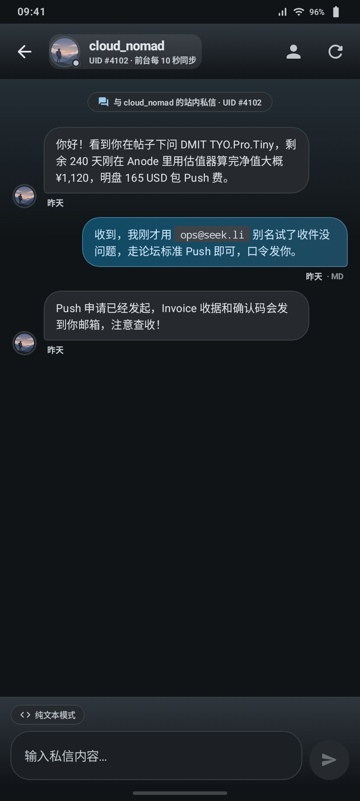</td>
    <td align="center"></td>
  </tr>
</table>
</div>

- **3 分栏收件箱 (`InboxScreen`)**：集成 `回复我`、`@我`、`私信` 三个实时分栏，支持一键全部已读、精准跳转原帖对应楼层，并内置通往 `脉搏雷达` 与 `Seek 邮箱` 的状态快链。
- **站内私信对话 (`DirectMessageScreen`)**：支持 Markdown 渲染、系统通知识别、自动保存私信草稿与前台静默轮询刷新。
- **用户空间 (`UserProfileScreen`)**：展示会员等级徽章、鸡腿/星尘数据、个人签名与 Markdown README，支持关注/取关、发私信、加入/移出屏蔽名单，查看 TA 发布的主题（同步统一为首页同款 `PulseTopicCard` 通透线框帖子卡片形式）与历史回复；浏览本人空间时可直接编辑个人资料。

---

### 7. 脉搏雷达：本地关键词/正则监控与帖子追更 (`Pulse Radar`)

<div align="center">
<table>
  <tr>
    <th width="50%">📡 命中警报流与系统通知诊断</th>
    <th width="50%">⚙️ 多版块关键词与正则表达式规则</th>
  </tr>
  <tr>
    <td align="center">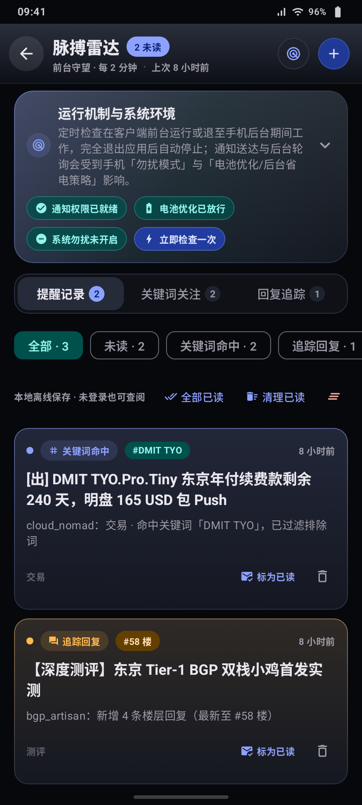</td>
    <td align="center">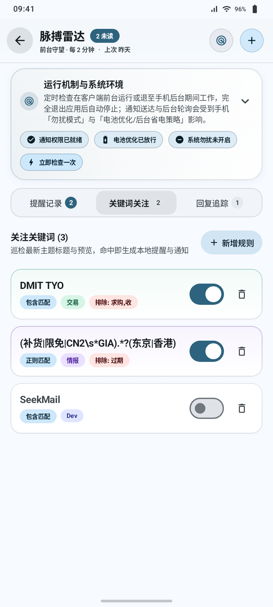</td>
  </tr>
</table>
</div>

- **本地规则引擎 (`PulseRadarScreen`)**：
  - 支持新增「包含关键词」或「正则表达式 (`REGEX`)」监控规则，可按指定版块（如 `trade` / `info`）过滤并配置英文逗号分隔的排除词（如过滤 `求购,收`），避免求购贴误报。
  - 任意帖子阅读页顶栏可一键开启「追更」，新楼层产生时记录提醒并直达目标楼层。
- **可调巡检与免打扰策略**：内置环境诊断横幅（通知权限、电池优化白名单、系统勿扰检测），可分别配置前台轮询（1–30 分钟）、后台轮询（15–60 分钟，受 Android WorkManager 最小周期限制）、仅 Wi-Fi 后台巡检及夜间免打扰时段（默认 `23:00–07:00`，支持自定义起止时间），无论是否登录均可依赖 RSS + Web 双通道工作。

---

### 8. Seek 邮箱：独立安全 `seek.li` 客户端 (`Seek Mail`)

<div align="center">
<table>
  <tr>
    <th width="50%">📬 多别名收件箱与 OTP 验证码自动提取</th>
    <th width="50%">🛡️ 隐私隔离阅读器与安全遥测</th>
  </tr>
  <tr>
    <td align="center">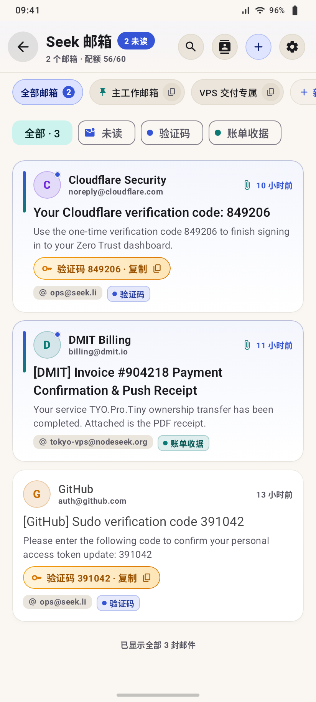</td>
    <td align="center"></td>
  </tr>
</table>
</div>

- **功能栏入口、页内密钥闭环与会话隔离 (`SeekMailApiClient`)**：从底部导航栏 **「功能栏 → 邮箱」** 进入独立收件箱（功能栏卡片实时显示 `已配置 / 待配置` 状态）；顶栏内置独立的 API Key 密钥管理弹窗（支持连通性验证、保存与断开密钥），闭环管理无需跳转设置。网络层基于 `https://seek.li/openapi/v1` 构建，强制启用 `CookieJar.NO_COOKIES`、禁用跨站重定向、严格校验请求 Origin，与 NodeSeek 主站会话彻底隔离——即使不登录社区也能独立使用邮箱。
- **多邮箱、批量多选管理（存档/删除/已读/标签）**：支持全部收件箱与各独立别名（如 `@seek.li` / `@nodeseek.org`）切换、一键复制地址、检查可用性并创建新别名、关键字搜索与联系人目录；支持长按单封邮件，或通过点击头像 / 筛选栏「多选」/ 长按菜单进入**批量多选模式**（支持一键全选），对多封邮件批量**存档 / 取消存档**、**打本地自定义标签**、**标为已读**或**删除**（带二次确认与底部提示栏撤销，按 API Key 隔离原子持久化），顶部筛选栏支持在 `全部 / 未读 / 已存档 / 标签` 之间一键切换。
- **智能验证码提取 (`VerificationCodeExtractor`)**：自动识别中英文验证码邮件并在列表与详情页高亮显示验证码徽章，一键复制即可填入登录验证。
- **零追踪隐私阅读器 (`SeekMailWebView`)**：经 `Jsoup` 白名单消毒与移动端自适应排版的邮件渲染器，严格禁用 JavaScript、文件访问与第三方 Cookie，默认拦截远程追踪图片（支持按封手动放行），自动适配 `Paper Light` / `Obsidian Dark` / `Pure Pitch AMOLED` 与字体缩放，支持切换 `HTML 视图` / `纯文本`，并提供 `SPF · DKIM · DMARC` 验证遥测与附件 SAF 导出下载。

---

### 9. 功能栏 · VPS 玩家工具箱与效率套件 (`Feature Hub & VPS Toolbox`)

<div align="center">
<table>
  <tr>
    <th width="50%">⚡ VPS 补货 / 抢购监控</th>
    <th width="50%">🛡️ 交易前“查一查”卖家信誉卡</th>
  </tr>
  <tr>
    <td align="center">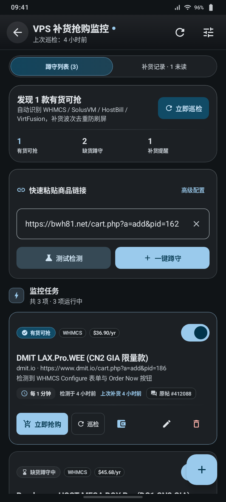</td>
    <td align="center">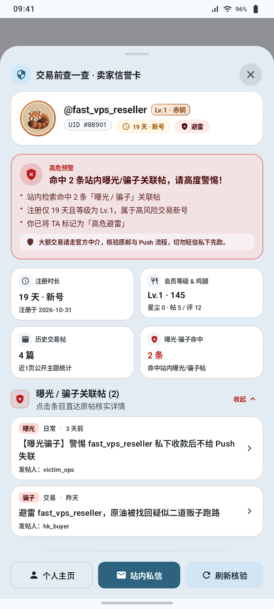</td>
  </tr>
</table>
</div>

<div align="center">
<table>
  <tr>
    <th width="50%">📡 我的服务器 · 哪吒/Komari 探针监控</th>
    <th width="50%">📒 我的服务器 · 资产账本与一键出机</th>
  </tr>
  <tr>
    <td align="center">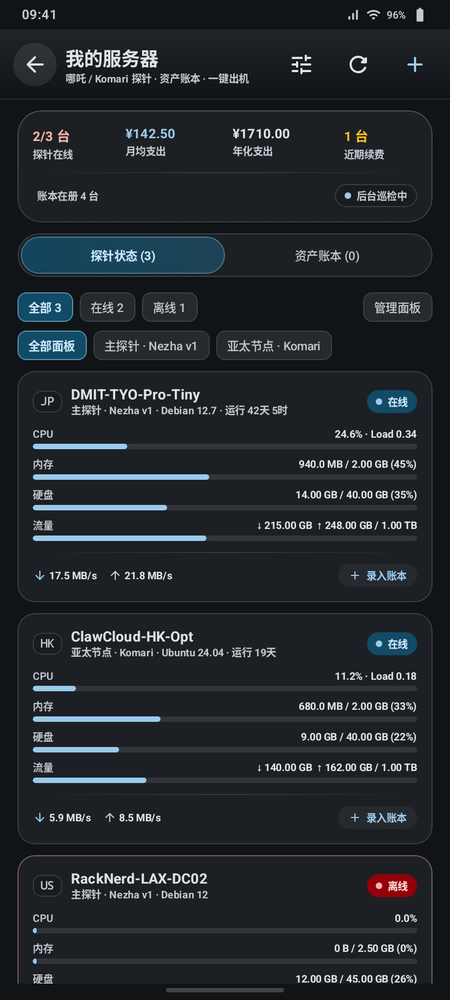</td>
    <td align="center">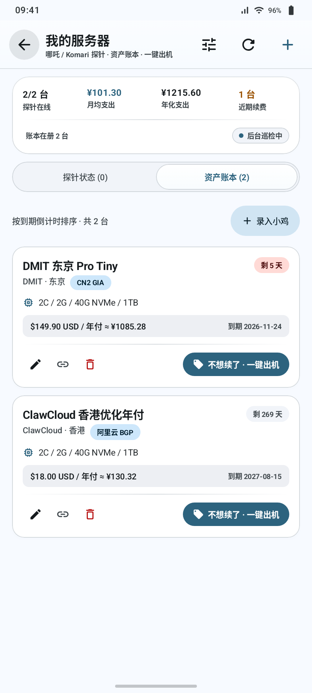</td>
  </tr>
</table>
</div>

<div align="center">
<table>
  <tr>
    <th width="33%">📶 手机端测机 · Ping / TCPing / iperf3</th>
    <th width="33%">💻 轻量 SSH · 一键脚本与自适应终端</th>
    <th width="33%">🌐 海外情报 · LET 加密接口与过滤</th>
  </tr>
  <tr>
    <td align="center">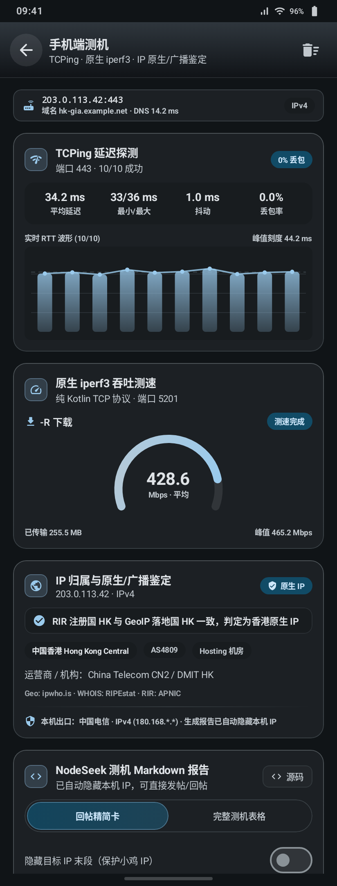</td>
    <td align="center">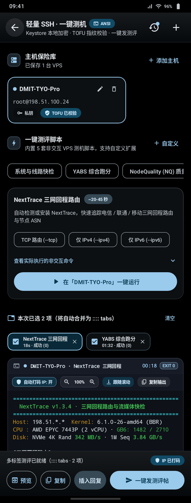</td>
    <td align="center">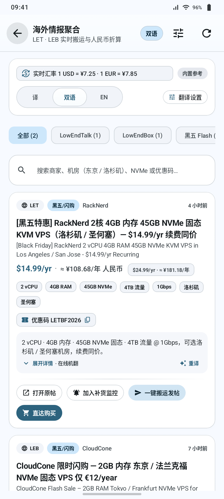</td>
  </tr>
</table>
</div>

- **功能栏聚合中心与社区活动专题 (`FeatureHubScreen` · `ActivityScreen`)**：底部中间「功能栏」主标签按 **社区服务**（`邮箱` / `活动`）、**情报与监控**（`海外情报` / `补货监控`）、**主机与网络**（`我的服务器` / `手机端测机`）与 Hero **轻量 SSH** 分组汇聚全部效率入口，实时展示 Seek 邮箱配置状态、进行中社区活动场次、补货监控启用数与未读提醒、探针主机数量与 SSH 保险库台数；「活动」页正式接入 **ForumWatch 社区活动签名加密 API**（TLS 证书/SPKI 固定与备用 Pin 轮换支持、`HMAC-SHA256` 请求签名、`AES-256-GCM` 响应信封解密——用于传输校验与基础防爬，不涉及用户个人账号/隐私数据、`ETag/304` 零字节条件缓存与同源帖子去重），基于明确抽奖/开奖链接精准区分「抽奖」与抢楼/赠送福利/限时特惠等「其他活动」，提供 **Material 3 二级筛选栏**（`全部 / 抽奖 / 其他活动` + 仅在「抽奖」下展开的 `进行中 / 即将开始 / 已结束` 开奖状态子筛选）、开奖时间提取与紧凑卡片、1 楼 Markdown 详情底栏、NodeSeek 帖子原生直跳，以及页内默认关闭的可选「新活动通知」开关（首次开启静默建档防历史刷屏，支持前后台低频巡检与点击通知直达原帖）。
- **VPS 补货 / 抢购监控 (`RestockMonitorScreen`)**：自动识别 WHMCS / SolusVM / HostBill / VirtFusion 面板购买页（支持顶栏粘贴链接或帖子内长按商品链接加入监控），后台 `缺货 → 有货` 波次去重巡检并发送高优先级通知，点击直跳下单页，亦支持一键导入资产账本。
- **交易前“查一查”卖家信誉卡 (`SellerTrustCardSheet` · `SellerTrustQuickBadge`)**：采用 **内存 LRU + 本地磁盘两级缓存（v2）**（正结果 18 小时 / 部分失败 15 分钟 / 负结果 3 分钟 / 7 天过期兜底）、单飞请求合并与 `429/503` 退避冷却保护；通过**本地缓存版块交叉回填 + 真实交易语料/成交结帖标题识别 + 自适应低频多页扫描（默认最多 6 页 90 篇，支持一键断点续扫更早历史）**精准统计卖家历史交易帖；默认打开通过共享 `/categories/expose` 曝光版快照匹配（**零 `/search` 流量**），并提供按需单次深度 `/search` 查验、Google `site:www.nodeseek.com` 站外兜底、全版块帖子与主页一致常驻的快捷查信誉徽章及本机私人标签备注；同时支持在设置中配置 **NodeSeek 官方交易平台（`agent.nodeseek.org`）** API Key（Android Keystore 本机加密保存、不随备份导出），在信誉卡中独立展示卖家成功交易场次、累计成交金额（¥）、最近成交时间与买家/卖家/中介分角色明细（重名账号自动逐条标注平台用户 ID，快捷徽章仅零网络读取本地缓存展示官方成交标记）。
- **我的服务器：2s 探针实时遥测 + VPS 资产账本 (`MyServersScreen`)**：同时接入哪吒探针 v0/v1 与 Komari（含官方 RPC2）面板 API，前台可见态下 **2s 静默平滑刷新**主机实时在线状态，提供紧凑四列横条卡片与虚拟化紧凑列表（实时展示 CPU / 内存 / 硬盘 / 带宽）、月流量耗尽预测、80% 流量告警与掉线/闲置洞察（绘制阶段无闪烁动画与去重精简顶栏）；内置 Material 3 Expressive 多币种续费资产账本，支持**多选预设/自定义标签芯片**、到期与逾期提醒、**一键「已续费」自动按周期顺延到期日**（含月末/闰年钳位与多周期逾期顺延）、**「自动续费」到期自动滚动**，以及点击「不想续了 · 一键出机」直接联动估值器生成交易帖并跳入发帖页。
- **手机端测机 (`MobileNetBenchScreen`)**：
  - **内核级物理绑定 ICMP Ping + TCPing 双重探测**：采用原生非阻塞 `AF_INET/AF_INET6` `SOCK_DGRAM` `IPPROTO_ICMP` 套接字配合 `Network.bindSocket` 真正绕过 VPN/代理直连物理蜂窝/Wi-Fi 网卡（外部 `/system/bin/ping` 仅作权限降级兜底），搭配防 Fake-IP 物理链路 DoH 解析与 `Proxy.NO_PROXY` TCPing，协同绘制零分配 `Canvas` 波形。
  - **双出口 IP 解析与物理网络绑定 (`NetBenchNetworkSelection` / `NetBenchNetworkBinding`)**：支持通过 `ConnectivityManager` 将 ICMP Ping、TCPing、iperf3 与 IP 查询绑定至真实蜂窝/Wi-Fi 物理网卡，清晰对照**真实本机出口 IP** 与**代理/VPN 出口 IP**。
  - **原生 `iperf3` `-P` 并发流、`-O` 慢启动预热剔除、自定义时长与图文混排论坛报告**：默认 `10s` 单向时长对齐官方 `iperf3` 并支持 `1–60s` 自定义时长，内置 `-O`（`0s / 1s / 2s`，默认 `1s`）TCP 慢启动预热剔除、上传方向服务端接收侧（`receiver`）权威速率对齐、`-P`（`1 / 2 / 4 / 8` 快捷档位与协议 `1..16` 流）并发测速及逐秒吞吐分段（per-second intervals）波动统计，联动 GeoIP / RIR RDAP 鉴定原生/广播 IP；支持离屏渲染适配论坛列宽的横版可视化卡片（IP 原生鉴定卡、Ping/TCPing 波形卡、iperf3 仪表盘与逐秒明细卡），通过官方 **NodeImage 图床**（`api.nodeimage.com`）自动上传并按章节嵌入完整 Markdown 报告（支持按单卡指纹缓存复用与脱敏同步）。
- **轻量 SSH：探针同步、双模交互终端与一键跑测评 (`LiteSshScreen`)**：
  - **探针同步与可折叠主机保险库 (`ProbeVaultSyncClient` · `SshProbeSyncMerger` · `SshServerVault`)**：内置 Android Keystore `AES-256-GCM` 主机保险库，支持从已启用的哪吒 v0/v1 与 Komari 面板一键同步主机 IP、地区、分组与标签（智能去重纳管并完整保留本地凭据与覆写配置、IP 迁移自动清理旧指纹）；列表支持**全保险库/分组/主机行三级可折叠视图并持久化折叠状态**，同时提供主机/预设搜索、`TOFU` SHA-256 指纹校验、**`SshJumpHostResolver` 多跳跳板机链路**（含成环检测）与后台前台服务 (`LiteSshForegroundService`) 保活。
  - **探针 WebSocket 终端 + 交互式直连 SSH (`ProbePanelTerminalClient` · `JSchSshTransport`)**：支持哪吒 v1/v2 与 Komari 面板原生 **WebSocket PTY「探针终端」**以及基于 JSch `ChannelShell` 的通用交互式 **「直连 SSH」**，按主机一键切换连接模式，兼顾实时交互输入与预设测评脚本执行。
  - **非交互自动应答与独立通道联动测速**：支持预设脚本自动应答引擎（`SshPromptAutoResponder` 回显去重、防抖与静默进度检测）、分组执行历史，以及通过独立 SSH 通道并发装/启/停远端 VPS `iperf3 -s`。
  - **通用终端自适应缩放 (`SshTerminalAutoFit`)**：支持 `AUTO_FIT`（按宽行自动计算字号避免表格折行）与 `FIXED` 模式切换、双指捏合（`0.50x–1.80x`）与 `+/-` 缩放重置，并向远端 PTY 实时同步 `window-change` 窗口尺寸（防反馈循环与历史视图误触发）。
  - **NodeQuality 零 ANR 流水线与官方格式导出 (`NodeQualityReportFormatter` · `SshResultPublishSheet`)**：采用 `\r` 进度压缩、多行 TrueColor 横幅 `CSI A/F` 擦除、零正则 `IpPrivacyMasker` 脱敏、词法高亮、`LazyColumn` 虚拟化与分块异步渲染彻底消除大日志卡顿；支持完美导出官方 `nodequality.com` 四标签（`💻基本信息 / 🎬IP质量 / 🌐网络质量 / 📍回程路由`）`:::: tabs` 与纯文本复制、多轮测评合并布局 (`SshMergeLayout`)、`ComposerPrefillStore` 大体量发帖传递及回帖情境下的 `发测评` 快捷按钮。
- **海外情报聚合与主动监控 (`OverseasIntelScreen`)**：接入 **LowEndTalk Promotion Monitor 签名加密 API**（`OverseasApiCrypto` 请求 `HMAC-SHA256` 签名 + `AES-256-GCM` 响应信封解密——用于传输校验与基础防爬，不涉及用户个人账号/隐私数据，支持时钟偏差自愈与 `ETag/304` 条件缓存+单飞请求合并）；内置 WorkManager 后台新促销主动雷达巡检与系统推送通知（页内一键开关）、可配置垃圾/求购杂讯过滤 (`OverseasOfferQualityFilter`)、清爽去噪卡片与一键中文搬运发帖。

---

### 10. 个性化设置与设计系统 (`Settings & Design System`)

<div align="center">
<table>
  <tr>
    <th width="50%">⚙️ 分组卡片式设置中心</th>
    <th width="50%">🎨 设计系统组件与遥测图鉴</th>
  </tr>
  <tr>
    <td align="center"></td>
    <td align="center"></td>
  </tr>
</table>
</div>

- **设置中心、内容过滤与双模式本地备份 (`SettingsScreen`)**：重构为与「我的」个人中心协调一致的圆角分组列表卡片与 `30.dp` 图标视觉规范，支持切换 `跟随系统 / 清雾浅色 / 深岩深色`、`Pure Pitch #000000 AMOLED`、Material You 动态取色、**首页卡片字号与卡片大小双轴独立设置**（仅作用于首页帖子列表，其余页面固定 `90%`；各自支持 `60% / 75% / 90% / 100% / 120%` 快捷档位、`60%–130%` 连续调节、一键恢复 `90%` 与双卡片实时预览）、`保底 +5 / 手气随机` 签到偏好、**`ContentFilterSection` 信息流内容过滤屏蔽**（静音版块、关键词/正则拦截规则）、NodeImage 图床 API Key 模态配置与连通性测试、脉搏雷达轮询与免打扰设置（冷启动并发竞态与 Worker 调度加固）、屏蔽用户管理、图片/浏览记录缓存清理，以及基于 GitHub Releases 的应用内版本检查、预发布通道开关与安全在线升级（官方 HTTPS 源站校验、APK 包名/签名证书一致性与防降级校验，及 Release 提供摘要时的 SHA-256 校验；剔除与邮箱页重复的 Seek Mail 配置项）：
  - **`BackupRestoreSection`（v1 核心数据 JSON 备份，向后兼容）**：覆盖偏好设置、脉搏雷达规则与追踪主题、内容过滤与屏蔽名单、本地收藏与编辑草稿；导出默认脱敏排除 API Key，需手动勾选才写入，支持导入前计数预览与合并/覆盖恢复。
  - **`EncryptedBackupSettingsSection`（v2 口令加密完整备份，可选）**：用户设置至少 8 位口令并二次确认，采用 `PBKDF2-HMAC-SHA256`（`310,000` 次迭代 + 256-bit 随机盐）派生密钥与 `AES-256-GCM`（96-bit 随机 Nonce + 128-bit 认证标签 + 文件头 AAD 绑定）加密打包为 `.anodebackup` 文件；在 v1 全部核心数据（含 API Key）基础上额外完整包含 **VPS 资产账本与探针面板（含 Token）**、**补货监控规则**、**SSH 主机保险库（含私钥/密码/自定义脚本）**、**Seek 邮箱设置与本地标签/归档**、**海外情报与社区活动偏好**、**卖家私人备注与官方交易 API Key** 以及 **测机/汇率校准偏好**。导入时严格校验口令与 GCM 防篡改标签（口令错误或篡改即中止且零写入），全程受加密 `BackupRestoreJournal` 事务日志保护支持原子回滚，并提供「合并 / 覆盖」双模式。

---

## 🏗️ 工程架构 · Architecture

Anode 采用清晰的单向多层架构（`ui` → `domain` ← `data`），通过轻量级构造器依赖注入（`AppContainer` / `DefaultAppContainer`）连接全部领域仓库与本地控制器：

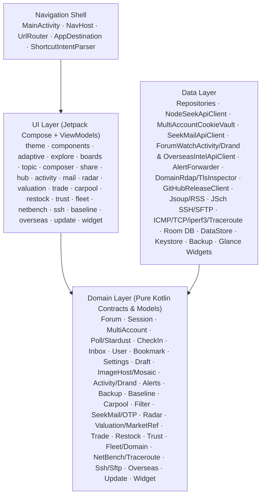

### Package Layout

```text
app/src/main/java/com/nodeseek/app/
├── MainActivity.kt                  # Edge-to-edge 宿主、WindowSizeClass 与 nodeseek.com 深度链接解析
├── NodePulseApp.kt                  # Application 入口、WorkManager 与容器生命周期初始化
├── di/                              # 领域仓库 CompositionLocal 契约与依赖图装配
├── navigation/                      # Kotlinx Serialization 类型安全导航、ComposerPrefillStore 与外链路由
├── notifications/                   # 通知渠道、Android 13+ 权限诊断与点击意图路由
├── domain/
│   ├── activity/                    # ForumWatch 社区活动领域模型、实时到期流转与前后台巡检控制器契约
│   ├── backup/                      # 版本化 JSON 核心备份（v1）与口令加密完整备份（v2）领域模型与契约
│   ├── filter/                      # 信息流与搜索关键词/正则过滤引擎及静音版块配置
│   ├── fleet/                       # 哪吒/Komari 探针聚合、VPS 资产账本与一键出机发帖模型
│   ├── mail/                        # SeekMail 模型、仓库接口与 VerificationCodeExtractor
│   ├── model/                       # 社区帖子、账户、社交与设置不可变模型
│   ├── netbench/                    # ICMP Ping、TCPing、纯 Kotlin iperf3 -P、网络选择与原生 IP 鉴定模型
│   ├── overseas/                    # LowEndTalk 促销情报模型、质量杂讯过滤器、术语译表与一键搬运排版
│   ├── radar/                       # Pulse Radar 规则、提醒记录与定位解析器
│   ├── repository/                  # 纯 Kotlin 领域仓库接口
│   ├── restock/                     # 补货监控目标识别、状态变更去重与配置模型
│   ├── ssh/                         # 轻量 SSH 预设、ProxyJump 解析、自动应答、TOFU 与 NodeQuality 官方四栏导出
│   ├── trust/                       # 交易前卖家信誉聚合与曝光版快照风控评估引擎
│   ├── update/                      # GitHub Releases 更新模型、SemVer 比较器与管理器接口
│   └── valuation/                   # BigDecimal VPS 剩余价值与过户交易估值引擎
├── data/
│   ├── activity/                    # ForumWatchActivityApiClient（TLS Pinning / HMAC / AES-GCM / ETag）、磁盘缓存与新活动巡检 Worker
│   ├── backup/                      # BackupManagerImpl（v1 核心数据 + v2 全量恢复）、BackupCryptoV2（PBKDF2-HMAC-SHA256 + AES-256-GCM）与加密 WAL 事务回滚日志
│   ├── fleet/                       # 哪吒 v0/v1 / Komari 探针 API 客户端、资产持久化与巡检 Worker
│   ├── local/                       # Room 数据库（离线收藏快照、阅读进度、雷达规则、版块）与 DataStore
│   ├── mail/                        # 会话隔离 SeekMailApiClient、Jsoup HTML 消毒器与磁盘缓存
│   ├── netbench/                    # IcmpPingRunner、TcpPingRunner、Iperf3ClientRunner、物理网卡绑定与 GeoIP/RDAP
│   ├── network/                     # OkHttp 客户端、CSRF 存储、WebView Cookie 桥接与 Coil 工厂
│   ├── overseas/                    # OverseasIntelApiClient（HMAC-SHA256 / AES-256-GCM / ETag）与多级翻译仓库
│   ├── parser/                      # Jsoup window.__config__ 注水解析、RSS XML 与 HTML→Markdown
│   ├── radar/                       # PulseRadarMonitor 与 PulseRadarWorker 后台巡检及关键词/正则匹配
│   ├── repository/                  # 各仓库实现与 DTO 映射层
│   ├── restock/                     # 购买页面板识别探测、WorkManager 补货巡检与持久化存储
│   ├── ssh/                         # Keystore AES-256-GCM 主机保险库与 JSch PTY/ProxyJump 执行器
│   ├── trust/                       # SellerTrustRepositoryImpl（两级缓存 / 曝光版快照 / 限流退避 / 私人备注）
│   ├── update/                      # Cookie 隔离 GitHubReleaseClient、APK 安装器与更新调度实现
│   └── valuation/                   # Frankfurter 汇率仓库（含 24h 本地缓存与手动校准）
└── ui/
    ├── theme/                       # 清雾浅色/深岩深色/Pitch 色板、15 版块规范、Lv.0–6 等级光环与默认 90% 排版缩放
    ├── components/                  # PulseTopicCard、FloatingPillDock、MarkdownRenderer、ANSI/贴纸支持
    ├── adaptive/                    # 平板与折叠屏双栏主从视图（AdaptiveLayout）与侧边 NavigationRail
    ├── activity/                    # 社区活动聚合页（状态筛选、详情 Markdown 底栏、新活动通知开关与权限绑定）
    ├── explore/                     # 脉冲首页流 Screen & ViewModel（支持再点置顶刷新）
    ├── boards/                      # 全站统一搜索与版块过滤 Screen & ViewModel
    ├── topic/                       # 杂志级帖子阅读器、楼层滑块与快捷回复工作台
    ├── composer/                    # Markdown 发帖/改帖编辑器与 NodeImage 上传
    ├── hub/                         # 个人中心、功能栏聚合中心（FeatureHubScreen）、收藏与足迹、签到榜、收件箱、私信、用户空间与分组设置（含内容过滤与备份恢复）
    ├── restock/                     # VPS 补货监控列表、快速探测与商品链接添加弹窗
    ├── trust/                       # 卖家信誉卡 BottomSheet、按需深度查验状态与风险快捷徽章
    ├── fleet/                       # 我的服务器（探针遥测、资产账本与一键出机估值弹窗）
    ├── netbench/                    # 手机端测机主界面、iperf3 服务端弹窗、波形图与长按快捷探测弹窗
    ├── ssh/                         # 轻量 SSH 主机保险库、虚拟化自适应 ANSI 控制台、前台服务与测评合并导出面板
    ├── overseas/                    # 海外情报聚合列表、层级化优惠卡片、可配置质量过滤与结构化详情页
    ├── mail/                        # SeekMailScreen（含页内 API Key 弹窗）、SeekMailViewModel 与隔离式 SeekMailWebView
    ├── radar/                       # PulseRadarScreen & ViewModel（规则管理、提醒流与追更追踪）
    ├── update/                      # AppUpdateDialog（更新提醒弹窗、日志渲染与下载安装进度）
    ├── valuation/                   # VpsValuationBottomSheet（实时遥测、汇率同步与 Markdown 导出）
    └── preview/                     # Compose @Preview 组件设计与全模块展示图库
```

更多工程与协议细节请参阅 [`docs/design-spec.md`](docs/design-spec.md) 与 [`docs/nodeseek-protocol.md`](docs/nodeseek-protocol.md)。

---

## 🧰 技术栈 · Tech Stack

| 领域 | 技术选型 |
| :--- | :--- |
| **语言与构建工具链** | Kotlin `2.4.21` · Java `17` · Android Gradle Plugin `9.5.2`（Built-in Kotlin） · Gradle `9.9.2` · KSP `2.3.14` |
| **Android SDK** | `minSdk = 26`（Android 8.0） · `targetSdk = 36`（Android 16） · `compileSdk = 37.1`（Android 17） |
| **UI 与设计系统** | Jetpack Compose（`BOM 2026.11.01` · Compose `1.13.0` / Material3 `1.5.0`） · Material 3 Expressive · Jetpack Glance `1.2.0`（桌面小组件） · WindowSizeClass · Edge-to-Edge WindowInsets |
| **导航与生命周期** | Navigation Compose `2.10.2`（Type-safe Kotlinx Serialization 路由与 App Shortcuts） · Lifecycle `2.11.1` |
| **网络、SSH 与解析** | OkHttp `5.5.1` · JSch (`com.github.mwiede:jsch` `2.28.8`，SSH + SFTP) · Jsoup `1.24.1` · Kotlinx Serialization JSON `1.13.0` · AndroidX WebKit `1.18.0` |
| **本地持久化与后台** | Room `2.8.5`（离线帖子快照、阅读楼层、雷达数据与导出 Schema） · Preferences DataStore `1.3.0` · WorkManager `2.12.0` |
| **图片与二维码** | Coil `3.6.3`（`coil-compose` + `coil-network-okhttp` + GIF / SVG 解码与 Referer 策略） · AndroidX ExifInterface `1.4.2` · ZXing Core `3.5.3`（帖子长图分享二维码） |
| **测试体系** | JUnit `4.13.2` · Kotlinx Coroutines Test `1.11.0` · OkHttp `MockWebServer` `5.5.1` · Room Testing `2.8.5`（真实 SQLite 迁移与 DAO 仪器化测试） |

---

## 🛠️ 本地构建与测试 · Build & Verification

### 环境要求
- **JDK 17**（Gradle 构建与 Compose Preview 渲染需运行在 Java 17 上）
- **Android SDK Platform 37.1**（在项目根目录配置 `local.properties` 或环境变量 `ANDROID_HOME`）

### 构建 APK
```bash
# 构建 Debug APK
./gradlew assembleDebug

# 构建 Release APK（若配置了本地签名则自动签名）
./gradlew assembleRelease
```
产物输出目录：
- Release：`app/build/outputs/apk/release/`（配置签名后生成 `Anode-v2.13.1-release.apk`）
- Debug：`app/build/outputs/apk/debug/Anode-v2.13.1-debug.apk`

如需对 Release 进行本地签名，可在项目根目录创建未纳入版本控制的 `key.properties`（配置 `storeFile`、`storePassword`、`keyAlias`、`keyPassword`），或在 CI 环境中设置 `KEYSTORE_FILE`、`KEYSTORE_PASSWORD`、`KEY_ALIAS` 与 `KEY_PASSWORD`。

### 运行单元测试与 Lint 检查
```bash
./gradlew testDebugUnitTest
./gradlew lintDebug
```

---

## 🔒 隐私安全与免责声明 · Privacy & Disclaimer

- **第三方开源客户端**：Anode 为面向 NodeSeek 社区的第三方开源 Android 客户端，与 NodeSeek 官方无从属或背书关系。
- **本地凭据安全**：应用已关闭 Android 系统云备份与设备迁移（`allowBackup="false"`），论坛登录会话 Cookie、阅读记录、脉搏雷达规则与卖家本地私人备注（`seller_trust_notes.json`）均仅保存在用户本机沙盒存储中；轻量 SSH 主机凭据（私钥/密码）、探针面板 API Token、`NodeSeek` 官方交易平台 API Key 以及 `NodeImage` / `Seek Mail` API Key 均优先采用 **Android Keystore `AES-256-GCM`** 硬件/系统级密钥在本地加密存储（在部分不支持 Keystore 的设备或 JVM 环境下会降级为应用私有无备份目录的软件 `AES-256-GCM` 密钥并在相关界面明确提示），绝不上传至任何第三方统计或中转服务器；外站图床、邮件、社区活动与海外情报（`HMAC-SHA256` 签名 + `AES-256-GCM` 响应解密）以及测机/翻译接口均采用严格的 Cookie 隔离与本机 IP 自动脱敏策略。若用户主动使用「加密完整备份 (v2)」导出全量迁移包，所有敏感凭据（SSH 私钥/密码、探针 Token、官方交易及图床/邮箱 API Key）仅在用户自设口令派生的 `AES-256-GCM` 密文包内受保护存储，绝不以明文落盘，且导入后立即经目标设备 Keystore 重新加密保存。
- **合规安全验证**：当触发登录、两步验证（2FA）或站点安全检查时，应用通过内置官方网页视图由用户本人手动完成，不采用任何自动化脚本规避站点校验机制。
- **开源协议**：本项目基于 [MIT License](LICENSE) 开源。
