<div align="center">


# Anode

**Editorial Paper & Obsidian Telemetry**  
面向 [NodeSeek](https://www.nodeseek.com) 主机与开发者社区的原生 Jetpack Compose / Material 3 Expressive Android 客户端

[](https://github.com/learningdog1/Anode/releases/latest)
[-0B7A75?style=for-the-badge&logo=android&logoColor=white)](https://github.com/learningdog1/Anode/releases/latest)
[](https://kotlinlang.org)
[](https://developer.android.com/compose)
[](LICENSE)

[📥 下载安装](#-下载与安装--download--install) ·
[🎨 三态视觉主题](#-三态视觉主题同屏对比--themes--design-philosophy) ·
[✨ 全页面功能图鉴](#-核心功能与全页面图鉴--feature--screen-walkthrough) ·
[🏗️ 工程架构](#️-工程架构--architecture) ·
[🛠️ 构建与测试](#️-本地构建与测试--build--verification)

</div>

---

## 📥 下载与安装 · Download & Install

> [!TIP]
> 前往 [**GitHub Releases (`v1.0.0`)**](https://github.com/learningdog1/Anode/releases/latest) 下载已签名正式版 APK（`Anode-v1.0.0-release.apk`），下载后可直接在 Android 设备安装。

| 项目 | 说明 |
| :--- | :--- |
| **应用名称 / 包名** | `Anode`（`com.nodeseek.app`） |
| **当前版本** | `v1.0.0`（`versionCode = 1`） |
| **系统要求** | Android 8.0 及以上（`minSdk = 26` · `targetSdk = 35`） |
| **核心模块一览** | 脉冲首页流 · 非对称 Bento 版块与统一搜索 · 杂志级帖子阅读器（ANSI / 多标签页 / 表情贴纸） · Markdown 发帖与 NodeImage 上传 · 13 币种 VPS 估值折算器 · 枢机中心与签到榜 · 聚合收件箱与实时私信 · 本地脉搏雷达监控 · 隔离式 Seek 邮箱客户端 (`seek.li`) |

---

## 🎨 三态视觉主题同屏对比 · Themes & Design Philosophy

**Anode** 将日间技术杂志的舒朗纸感与夜间机房遥测面板的锐利对比融于同一套 **Material 3 Expressive** 自适应色彩引擎：

- **暖感纸张日间 (`Paper Light`)**：米白纸张画布（`#FAF7F2`）搭配纯净白卡片（`#FFFFFF`）与 `1.dp` 建筑级描边（`#DBD5C9`），消除长文阅读眩光。
- **深邃黑曜夜间 (`Obsidian Dark`)**：深空曜石底色（`#07080C`）与碳灰层级卡片（`#151821`），配合 **Electric Cobalt (`#8DA2FF`)** 与 **Telemetry Teal (`#4FD8CE`)** 高对比点缀。
- **纯净极黑省电 (`Pure Pitch AMOLED`)**：支持纯黑 `#000000` 画布与低功耗深碳卡片（`#10131A`），专为 OLED 屏幕优化夜间阅读对比度。
- **动态取色与语义色板**：可选开启 Android 12+ Material You 动态调和；内置 **15 套版块语义色系**、**Lv.0–Lv.6 宝石/金属等级光环**（精确按 `coins >= 100 × Lv²` 换算）与 **Drumstick Amber (`🍗`)** 鸡腿激励体系。

<div align="center">
<table>
  <tr>
    <th width="33%">☀️ 暖感纸张日间 · Paper Light</th>
    <th width="33%">🌙 深邃黑曜夜间 · Obsidian Dark</th>
    <th width="33%">🖤 纯黑省电 · Pure Pitch AMOLED</th>
  </tr>
  <tr>
    <td align="center">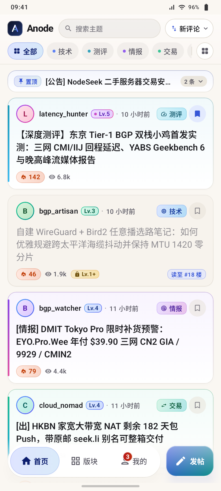</td>
    <td align="center">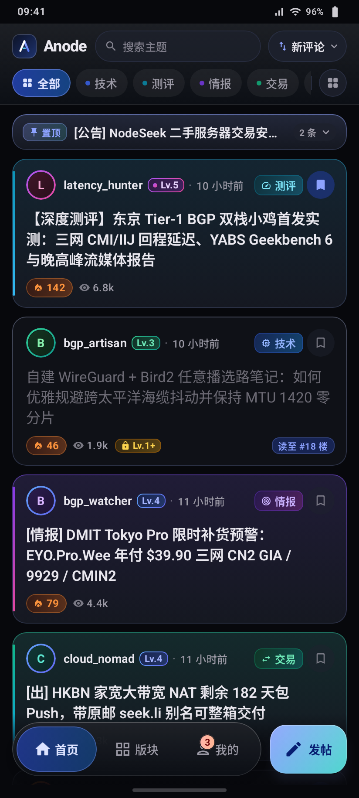</td>
    <td align="center">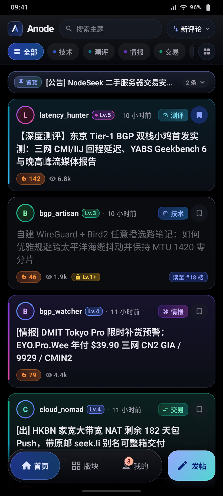</td>
  </tr>
</table>
</div>

---

## ✨ 核心功能与全页面图鉴 · Feature & Screen Walkthrough

### 1. 脉冲首页与悬浮药丸导航 (`Explore & Navigation Shell`)

- **毛玻璃顶栏与快速切换**：内置 `Anode` 品牌徽标、全站搜索触发胶囊、4 路信息流排序切换（`新评论` / `新帖子` / `热门` / `推荐阅读`）以及可横向滑动的常驻版块轨道（`全部` + 用户星标版块）。
- **信息密度与阅读连续性**：
  - **CollapsiblePinnedTicker**：默认折叠的置顶公告滚动条，一键展开查看全站置顶。
  - **PulseTopicCard**：未读帖子左侧呈 `3.dp` 版块语义色脊线；已读帖子自动降低对比度并显示 `读至 #N 楼` 续读标签；支持热帖火焰徽章、`Lv.0–Lv.6` 等级头像环与一键收藏。
  - **RSS 快速降级通道**：未登录或触发临时安全校验时自动切换 RSS 快速预览，保证随时可读。
- **单手拇指区交互**：悬浮毛玻璃药丸底栏（`首页` / `版块` / `我的`）配以弹性渐隐 Squircle `发帖` FAB。

---

### 2. 版块矩阵与全站统一搜索 (`Boards Directory & Unified Search`)

<div align="center">
<table>
  <tr>
    <th width="50%">🧩 非对称 2 列 Bento 版块矩阵</th>
    <th width="50%">🔍 帖子 / 成员统一搜索与 Google 兜底</th>
  </tr>
  <tr>
    <td align="center">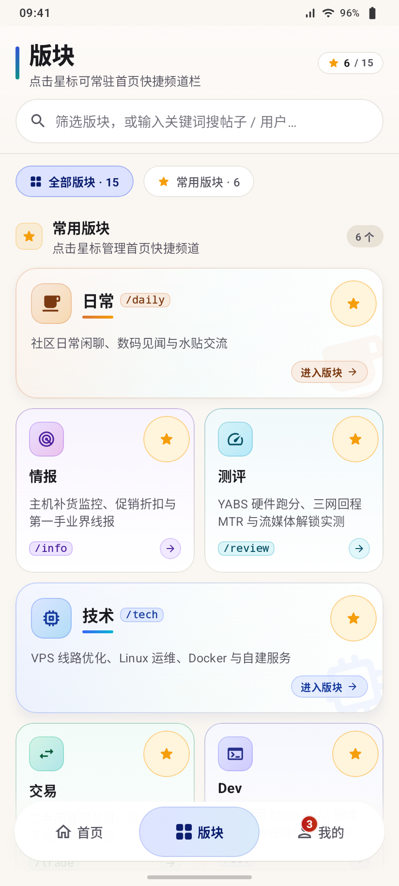</td>
    <td align="center"></td>
  </tr>
</table>
</div>

- **非对称 Bento 频道矩阵**：顶部 `2×1` Hero 渐变卡突出 `技术 /tech` 与 `测评 /review`，其余版块以 `1×1` 伴随磁贴整齐排布；清晰标注内版发帖消耗（`5 🍗`）、`RSS·Web` / `Web` 支持状态与频道简介。
- **一键常驻星标**：点击磁贴右上角星标即可弹性常驻至首页顶部频道栏，支持「全部频道 / 已常驻 ★ / 支持 RSS ⚡」快速筛选，也可在当前页内直接打开任意版块流。
- **全站统一搜索**：支持按 `找帖子`（含分类/排序筛选与分页加载）与 `找用户`（`@username`）检索，自动持久化最近搜索标签，并在底部提供 **1 键 Google `site:www.nodeseek.com` 站外搜索** 卡片。

---

### 3. 杂志级帖子阅读器与表情回复工作台 (`Topic Reader & Reply Composer`)

<div align="center">
<table>
  <tr>
    <th width="50%">📖 杂志级排版 · ANSI 跑分 · 多标签卡</th>
    <th width="50%">💬 引用回复 · 实时预览 · 社区贴纸库</th>
  </tr>
  <tr>
    <td align="center">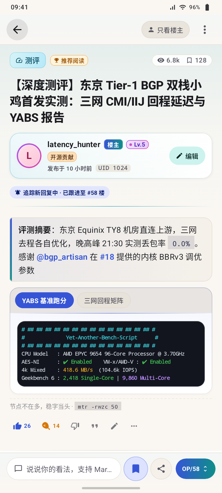</td>
    <td align="center">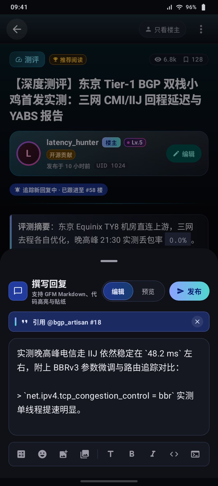</td>
  </tr>
</table>
</div>

- **原生 Compose `MarkdownRenderer`**：
  - **ANSI SGR 终端彩色代码块**：原生解析 `\u001B[...m` 控制符，高保真渲染 YABS、NextTrace、Geekbench 等 VPS 测速脚本输出，支持一键复制源码。
  - **交互式多标签页 (`:::: tabs` / `::: tab-item`)**：长篇评测内的「YABS 跑分 / 三网回程 / 流媒体解锁」可在卡片内直接切换。
  - **完整 GFM 与社区语法**：支持横向滚动表格、Electric Cobalt 引用块、任务列表、可点击 `@用户` / `#楼层` 跳转芯片、`/jump?to=` 外链安全解包、双指缩放灯箱看图（Coil 3 + Referer 策略），以及官方 `:ac01:` / `:yct001:` / `:xhj001:` 动态与静态贴纸集。
- **阅读与互动人体工学**：支持 `只看楼主`、倒序浏览、长按自由划词复制、楼层 `🍗 加鸡腿` / `👍 点赞` / `👎 踩`（含消耗确认弹窗与实时余额同步）、右侧可拖拽**震动楼层滑块 (`RightEdgeFloorScrubber`)** 与跳楼弹窗。
- **回复工作台 (`ReplyComposerBottomSheet`)**：支持引用任意楼层 `@user #N`、本地草稿自动保存、`编辑 / 预览` 双栏切换、官方贴纸面板、NodeImage 图床直传以及一键调用 VPS 估值器插入回复。

---

### 4. Markdown 发帖编辑器与 VPS 剩余价值估值器 (`Topic Composer & VPS Valuation`)

<div align="center">
<table>
  <tr>
    <th width="50%">✍️ 全功能 Markdown 发帖与编辑</th>
    <th width="50%">🧮 13 币种 VPS 剩余价值与交易折算</th>
  </tr>
  <tr>
    <td align="center">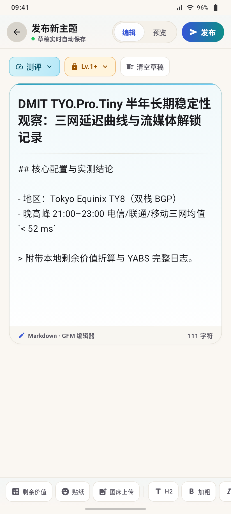</td>
    <td align="center"></td>
  </tr>
</table>
</div>

- **发帖 / 改帖编辑器 (`TopicComposerScreen`)**：
  - 版块选择器（自动过滤管理员版块并明确提示 `inside` 消耗 `5 🍗`），阅读权限分级选择器（`Lv.0 公开` ~ `Lv.6+` 及 `Lv.255 私有帖`）。
  - 快捷工具栏覆盖标题、粗斜体、代码块、引用、表格、`:::: tabs` 测评模板、贴纸面板、相册/文件图片上传（`api.nodeimage.com`）与草稿恢复。
- **VPS 剩余价值折算器 (`VpsValuationBottomSheet`)**：
  - **高精度 `BigDecimal` 算力引擎**：支持 **13 种主流货币**（`CNY / USD / EUR / GBP / HKD / JPY / CAD / AUD / SGD / CHF / KRW / TRY / BRL`），自动同步 Frankfurter 实时汇率（24 小时本地缓存 + 离线兜底 + 单币种手动覆写）。
  - **自然周期与闰年感知**：支持固定天数（月/季/半年/年/自定义）与自然日历周期（精确识别 365 / 366 闰年天数及 `Asia/Shanghai` 精确到时分计算）。
  - **二手交易与费用分摊**：支持出让挂牌价溢价/折价实时遥测标签、Push 过户费及中介费分摊（买家/卖家/各半平摊），一键生成**精简摘要卡**或**三栏核算表** Markdown 直接插入发帖或回帖光标处。

---

### 5. 枢机中心与每日签到手气榜 (`Pulse Hub & Check-In Leaderboard`)

<div align="center">
<table>
  <tr>
    <th width="50%">🏛️ 枢机仪表盘 · 等级进度 · 离线收藏</th>
    <th width="50%">🏆 每日签到手气榜与领奖台</th>
  </tr>
  <tr>
    <td align="center">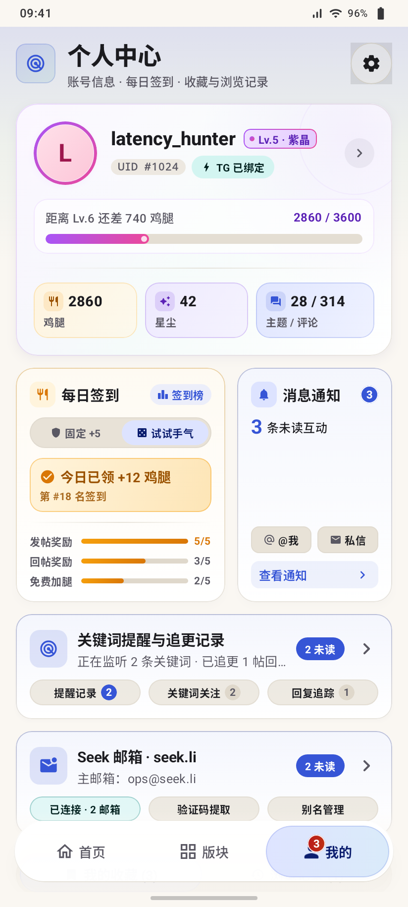</td>
    <td align="center">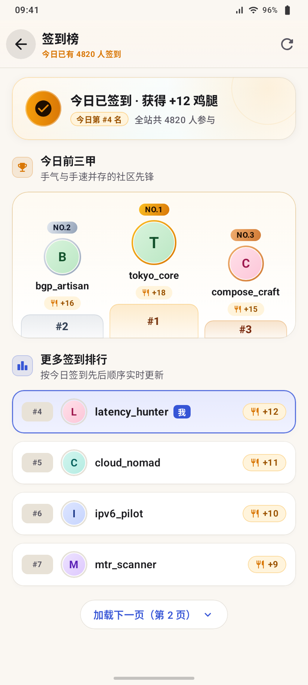</td>
  </tr>
</table>
</div>

- **枢机仪表盘 (`PulseHubScreen`)**：
  - **`2×1` 等级进度 Hero 卡**：实时展示当前等级 `Lv.0–Lv.6`、距离下一级所需鸡腿进度条、鸡腿/星尘余额与发回帖统计；未登录时支持官方 WebView 安全登录或原生凭据登录。
  - **交互式签到磁贴**：支持在 `保底 +5` 与 `🎲 手气随机` 间即时切换、查看今日发帖/回帖/免费鸡腿额度条，并直达每日手气榜。
  - **快捷入口与离线内容库**：聚合实时收件箱未读数、脉搏雷达未读命中、Seek 邮箱未读预览，以及整合 Room 本地完整离线快照的「收藏夹」与记录最后阅读楼层的「阅读足迹」。
- **签到榜 (`CheckInBoardScreen`)**：可视化前三甲领奖台、全站签到排名与自己的当日名次及手气收益。

---

### 6. 聚合收件箱、站内私信与用户空间 (`Inbox · Direct Messages · User Profile`)

<div align="center">
<table>
  <tr>
    <th width="33%">🔔 聚合收件箱 (回复 / @我 / 私信)</th>
    <th width="33%">💭 站内私信实时对话</th>
    <th width="33%">👤 用户空间与 README 档案</th>
  </tr>
  <tr>
    <td align="center">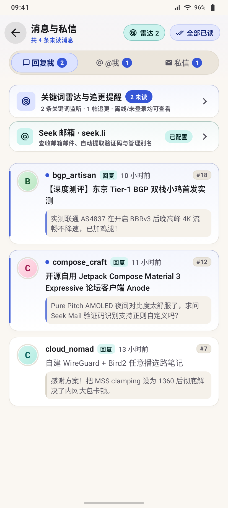</td>
    <td align="center"></td>
    <td align="center">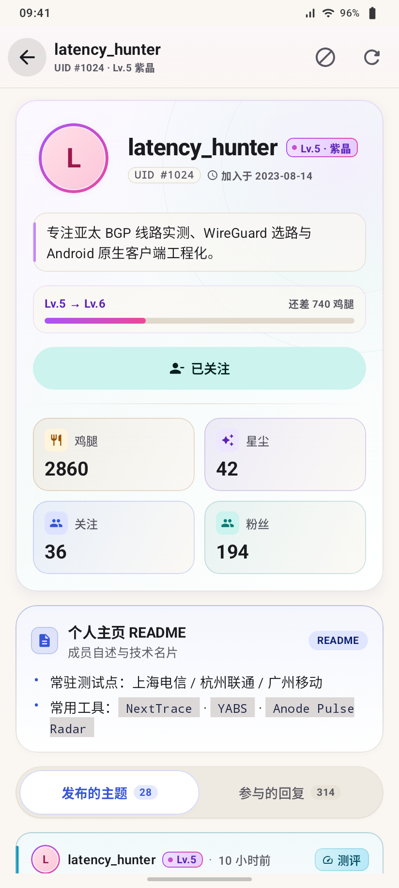</td>
  </tr>
</table>
</div>

- **3 分栏收件箱 (`InboxScreen`)**：集成 `回复我`、`@我`、`私信` 三个实时分栏，支持一键全部已读、精准跳转原帖对应楼层，并内置通往 `脉搏雷达` 与 `Seek 邮箱` 的状态快链。
- **站内私信对话 (`DirectMessageScreen`)**：支持 Markdown 渲染、系统通知识别、自动保存私信草稿与前台静默轮询刷新。
- **用户空间 (`UserProfileScreen`)**：展示会员等级徽章、鸡腿/星尘数据、个人签名与 Markdown README，支持关注/取关、发私信、加入/移出屏蔽名单，查看 TA 发布的主题与历史回复；浏览本人空间时可直接编辑个人资料。

---

### 7. 脉搏雷达：本地关键词/正则监控与帖子追更 (`Pulse Radar`)

<div align="center">
<table>
  <tr>
    <th width="50%">📡 命中警报流与系统通知诊断</th>
    <th width="50%">⚙️ 多版块关键词与正则表达式规则</th>
  </tr>
  <tr>
    <td align="center"></td>
    <td align="center"></td>
  </tr>
</table>
</div>

- **本地规则引擎 (`PulseRadarScreen`)**：
  - 支持新增「包含关键词」或「正则表达式 (`REGEX`)」监控规则，可按指定版块（如 `trade` / `info`）过滤并配置英文逗号分隔的排除词（如过滤 `求购,收`），避免求购贴误报。
  - 任意帖子阅读页顶栏可一键开启「追更」，新楼层产生时记录提醒并直达目标楼层。
- **可调巡检与免打扰策略**：内置环境诊断横幅（通知权限、电池优化白名单、系统勿扰检测），可分别配置前台轮询（1–30 分钟）、后台轮询（3–60 分钟）、仅 Wi-Fi 后台巡检及夜间免打扰时段（默认 `23:00–07:00`），无论是否登录均可依赖 RSS + Web 双通道工作。

---

### 8. Seek 邮箱：独立安全 `seek.li` 客户端 (`Seek Mail`)

<div align="center">
<table>
  <tr>
    <th width="50%">📬 多别名收件箱与 OTP 验证码自动提取</th>
    <th width="50%">🛡️ 隐私隔离阅读器与安全遥测</th>
  </tr>
  <tr>
    <td align="center"></td>
    <td align="center">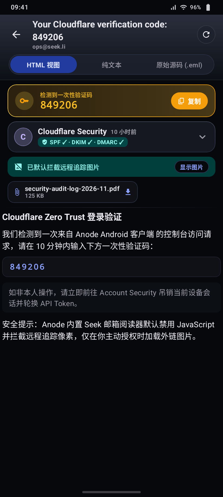</td>
  </tr>
</table>
</div>

- **会话完全隔离的 OpenAPI 客户端 (`SeekMailApiClient`)**：基于 `https://seek.li/openapi/v1` 构建，强制启用 `CookieJar.NO_COOKIES`、禁用跨站重定向、严格校验请求 Origin，与 NodeSeek 主站会话彻底隔离——即使不登录社区也能独立使用邮箱。
- **多邮箱与别名管理**：支持全部收件箱与各独立别名（如 `@seek.li` / `@nodeseek.org`）切换、一键复制地址、检查可用性并创建新别名、标签过滤、关键字搜索与联系人目录。
- **智能验证码提取 (`VerificationCodeExtractor`)**：自动识别中英文验证码邮件并在列表与详情页高亮显示验证码徽章，一键复制即可填入登录验证。
- **零追踪隐私阅读器 (`SeekMailWebView`)**：经 `Jsoup` 白名单消毒的邮件渲染器，严格禁用 JavaScript、文件访问与第三方 Cookie，默认拦截远程追踪图片（支持按封手动放行），自动适配 `Paper Light` / `Obsidian Dark` / `Pure Pitch AMOLED` 与字体缩放，支持切换 `HTML 视图` / `纯文本` / `原始源码 (.eml)`，并提供 `SPF · DKIM · DMARC` 验证遥测与附件 SAF 导出下载。

---

### 9. 个性化设置与设计系统 (`Settings & Design System`)

<div align="center">
<table>
  <tr>
    <th width="50%">⚙️ 主题、字体缩放、图床与密钥管理</th>
    <th width="50%">🎨 设计系统组件与遥测图鉴</th>
  </tr>
  <tr>
    <td align="center">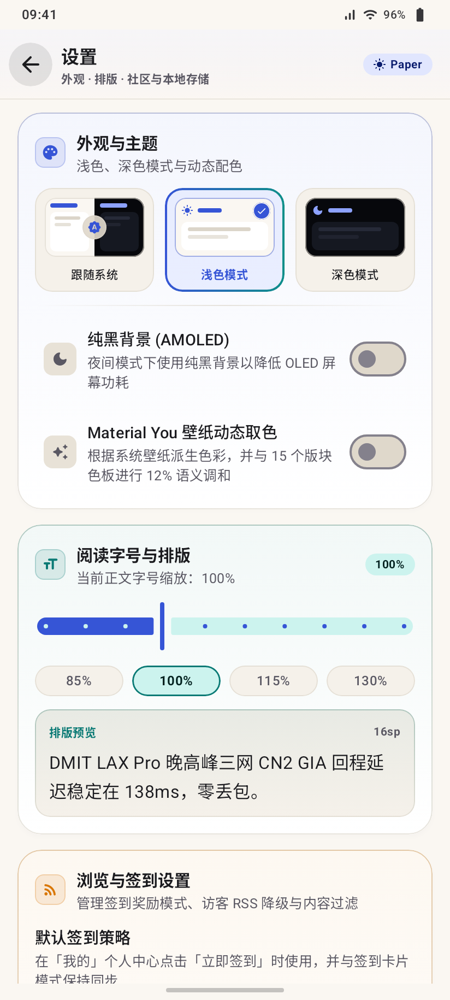</td>
    <td align="center">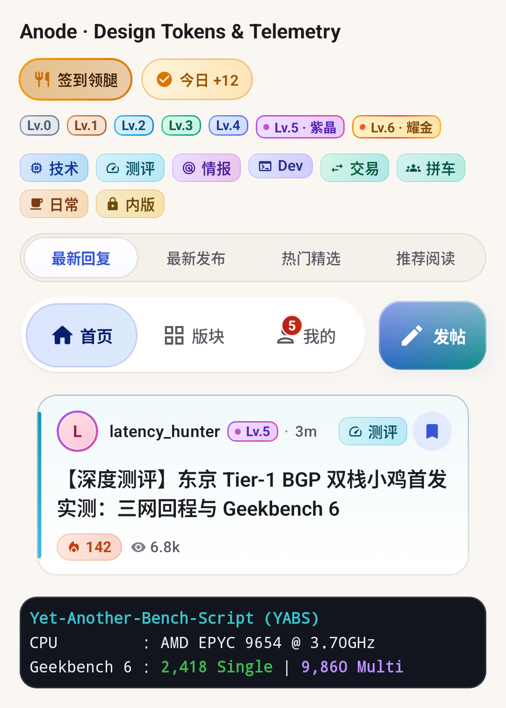</td>
  </tr>
</table>
</div>

- **设置中心 (`SettingsScreen`)**：支持可视化切换 `跟随系统 / 暖感纸张 / 深邃黑曜`、`Pure Pitch #000000 AMOLED`、Material You 动态取色、`85%–130%` 全局正文实时缩放、`保底 +5 / 手气随机` 签到偏好、NodeImage 与 Seek Mail API Key 连通性测试、屏蔽用户列表管理以及图片/阅读历史缓存清理。

---

## 🏗️ 工程架构 · Architecture

Anode 采用清晰的单向多层架构（`ui` → `domain` ← `data`），通过轻量级构造器依赖注入（`AppContainer` / `DefaultAppContainer`）连接全部 11 个领域仓库与本地控制器：

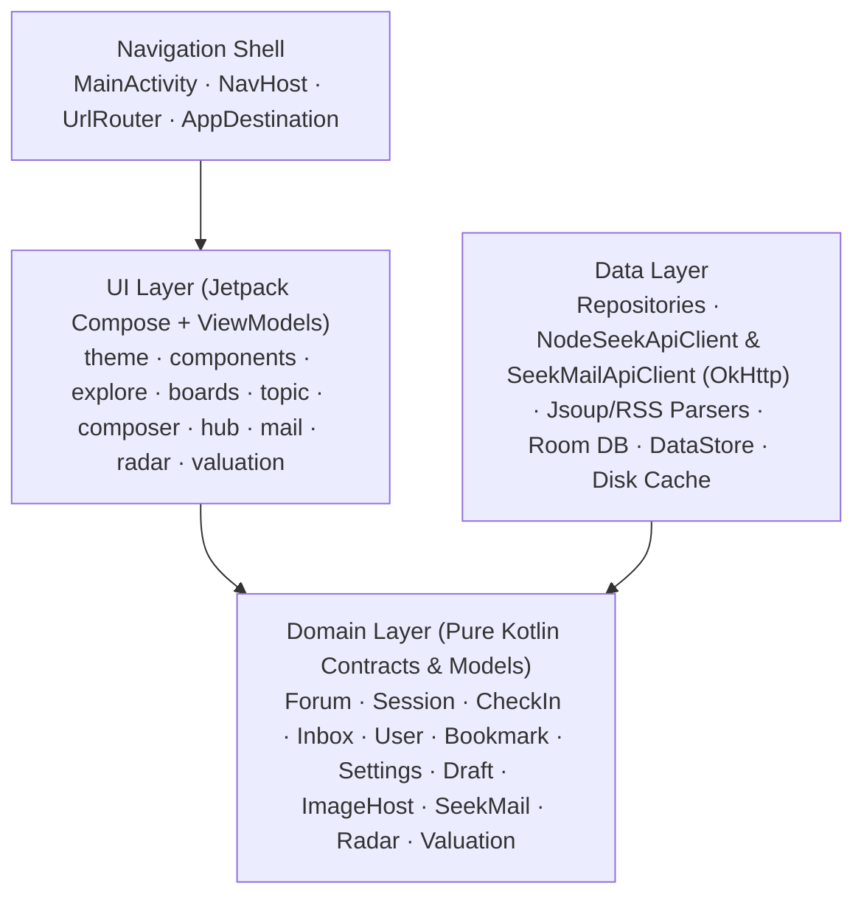

### Package Layout

```text
app/src/main/java/com/nodeseek/app/
├── MainActivity.kt                  # Edge-to-edge 宿主与 nodeseek.com 深度链接解析
├── di/                              # 领域仓库 CompositionLocal 契约与依赖图装配
├── navigation/                      # Kotlinx Serialization 类型安全导航、深度链接与外链路由
├── notifications/                   # 通知渠道、Android 13+ 权限诊断与点击意图路由
├── domain/
│   ├── mail/                        # SeekMail 模型、仓库接口与 VerificationCodeExtractor
│   ├── model/                       # 社区帖子、账户、社交与设置不可变模型
│   ├── radar/                       # Pulse Radar 规则、提醒记录与定位解析器
│   ├── repository/                  # 纯 Kotlin 领域仓库接口
│   └── valuation/                   # BigDecimal VPS 剩余价值与过户交易估值引擎
├── data/
│   ├── local/                       # Room 数据库（离线收藏快照、阅读进度、雷达规则、版块）与 DataStore
│   ├── mail/                        # 会话隔离 SeekMailApiClient、Jsoup HTML 消毒器与磁盘缓存
│   ├── network/                     # OkHttp 客户端、CSRF 存储、WebView Cookie 桥接与 Coil 工厂
│   ├── parser/                      # Jsoup window.__config__ 注水解析、RSS XML 与 HTML→Markdown
│   ├── radar/                       # PulseRadarMonitor 前后台轮询与关键词/正则匹配引擎
│   ├── repository/                  # 各仓库实现与 DTO 映射层
│   └── valuation/                   # Frankfurter 汇率仓库（含 24h 本地缓存与手动校准）
└── ui/
    ├── theme/                       # Paper/Obsidian/Pitch 色板、15 版块规范、Lv.0–6 等级光环与动效
    ├── components/                  # PulseTopicCard、FloatingPillDock、MarkdownRenderer、ANSI/贴纸支持
    ├── explore/                     # 脉冲首页流 Screen & ViewModel
    ├── boards/                      # 非对称 Bento 版块目录与统一搜索 Screen & ViewModel
    ├── topic/                       # 杂志级帖子阅读器、楼层滑块与快捷回复工作台
    ├── composer/                    # Markdown 发帖/改帖编辑器与 NodeImage 上传
    ├── hub/                         # 枢机中心 Bento、签到榜、收件箱、私信、用户空间与设置
    ├── mail/                        # SeekMailScreen、SeekMailViewModel 与隔离式 SeekMailWebView
    ├── radar/                       # PulseRadarScreen & ViewModel（规则管理、提醒流与追更追踪）
    ├── valuation/                   # VpsValuationBottomSheet（实时遥测、汇率同步与 Markdown 导出）
    └── preview/                     # Compose @Preview 组件设计图库
```

更多工程与协议细节请参阅 [`docs/design-spec.md`](docs/design-spec.md) 与 [`docs/nodeseek-protocol.md`](docs/nodeseek-protocol.md)。

---

## 🧰 技术栈 · Tech Stack

| 领域 | 技术选型 |
| :--- | :--- |
| **语言与构建工具链** | Kotlin `2.1.10` · Java `17` · Android Gradle Plugin `8.8.2` · Gradle `8.11.1` · KSP `2.1.10-1.0.31` |
| **Android SDK** | `minSdk = 26`（Android 8.0） · `targetSdk = 35` · `compileSdk = 35` |
| **UI 与设计系统** | Jetpack Compose（`BOM 2025.02.00`） · Material 3 Expressive · Edge-to-Edge WindowInsets |
| **导航与生命周期** | Navigation Compose `2.8.9`（Type-safe Kotlinx Serialization 路由） · Lifecycle `2.8.7` |
| **网络与解析** | OkHttp `4.12.0` · Jsoup `1.19.1` · Kotlinx Serialization JSON `1.8.0` · AndroidX WebKit `1.13.0` |
| **本地持久化** | Room `2.7.0`（离线帖子快照、阅读楼层与雷达数据） · Preferences DataStore `1.1.3` |
| **图片加载** | Coil `3.1.0`（`coil-compose` + `coil-network-okhttp` + GIF / SVG 解码与 Referer 策略） |
| **单元测试** | JUnit `4.13.2` · Kotlinx Coroutines Test `1.10.1` · OkHttp `MockWebServer` `4.12.0` |

---

## 🛠️ 本地构建与测试 · Build & Verification

### 环境要求
- **JDK 17**（Gradle 构建与 Compose Preview 渲染需运行在 Java 17 上）
- **Android SDK Platform 35**（在项目根目录配置 `local.properties` 或环境变量 `ANDROID_HOME`）

### 构建 APK
```bash
# 构建 Debug APK
./gradlew assembleDebug

# 构建 Release APK（若配置了本地签名则自动签名）
./gradlew assembleRelease
```
产物输出目录：
- Release：`app/build/outputs/apk/release/`（配置签名后生成 `Anode-v1.0.0-release.apk`）
- Debug：`app/build/outputs/apk/debug/Anode-v1.0.0-debug.apk`

如需对 Release 进行本地签名，可在项目根目录创建未纳入版本控制的 `key.properties`（配置 `storeFile`、`storePassword`、`keyAlias`、`keyPassword`），或在 CI 环境中设置 `KEYSTORE_FILE`、`KEYSTORE_PASSWORD`、`KEY_ALIAS` 与 `KEY_PASSWORD`。

### 运行单元测试与 Lint 检查
```bash
./gradlew testDebugUnitTest
./gradlew lintDebug
```

---

## 🔒 隐私安全与免责声明 · Privacy & Disclaimer

- **第三方开源客户端**：Anode 为面向 NodeSeek 社区的第三方开源 Android 客户端，与 NodeSeek 官方无从属或背书关系。
- **本地凭据安全**：论坛登录会话 Cookie、阅读记录、脉搏雷达规则及可选的 `NodeImage` / `Seek Mail` API Key 均仅保存在用户本机沙盒存储中，绝不上传至任何第三方统计或中转服务器；外站图床与邮件接口均采用严格的 Cookie 隔离策略。
- **合规安全验证**：当触发登录、两步验证（2FA）或站点安全检查时，应用通过内置官方网页视图由用户本人手动完成，不采用任何自动化脚本规避站点校验机制。
- **开源协议**：本项目基于 [MIT License](LICENSE) 开源。
